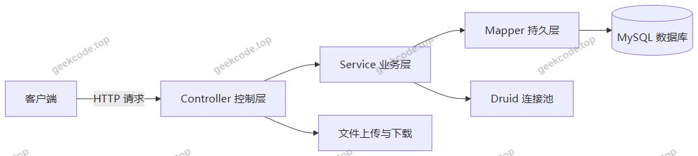
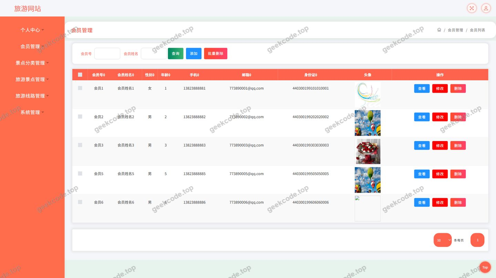
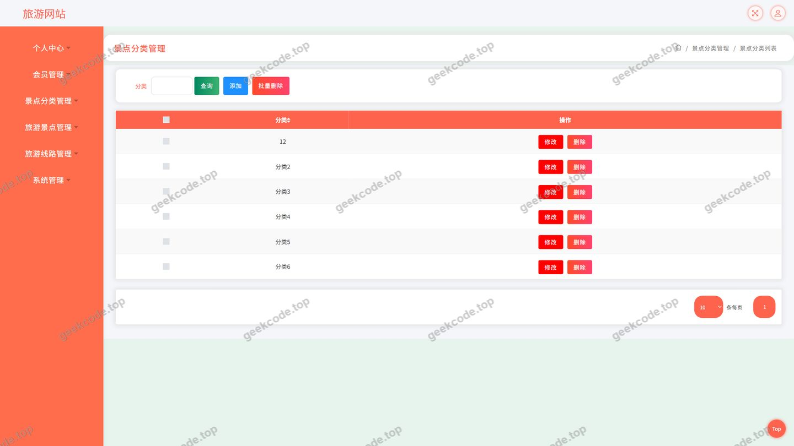
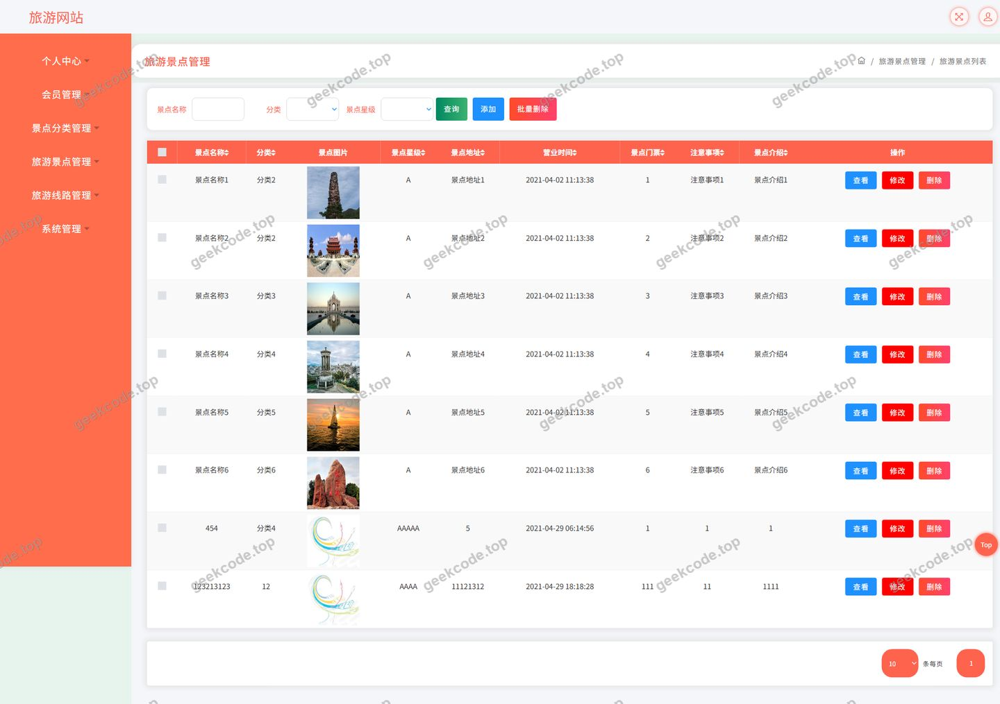
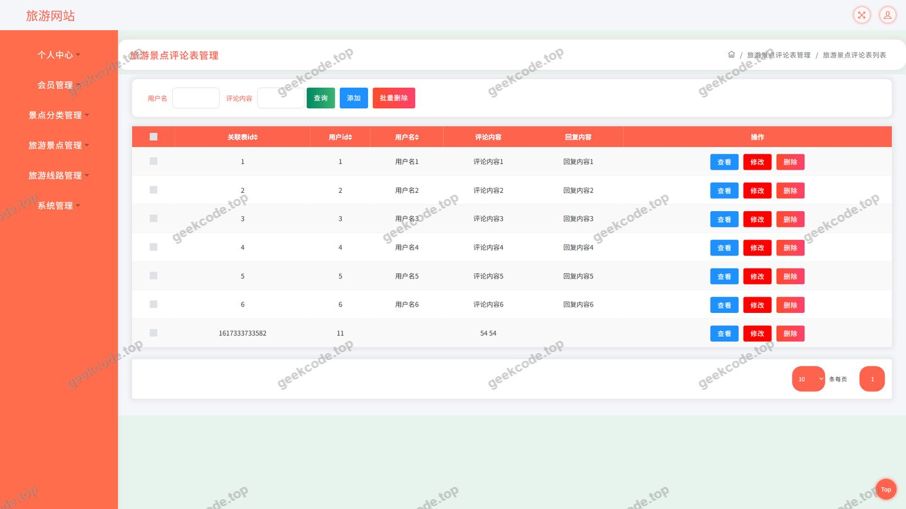
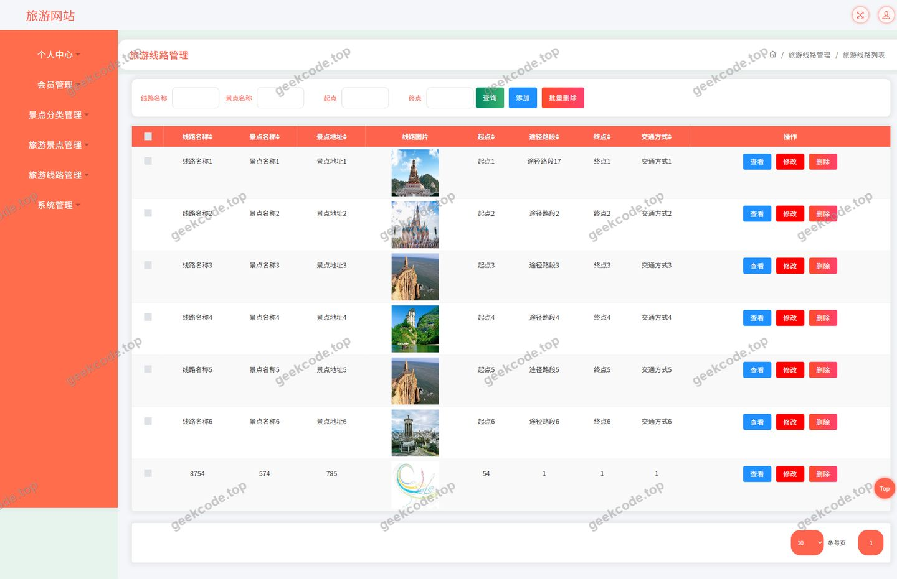
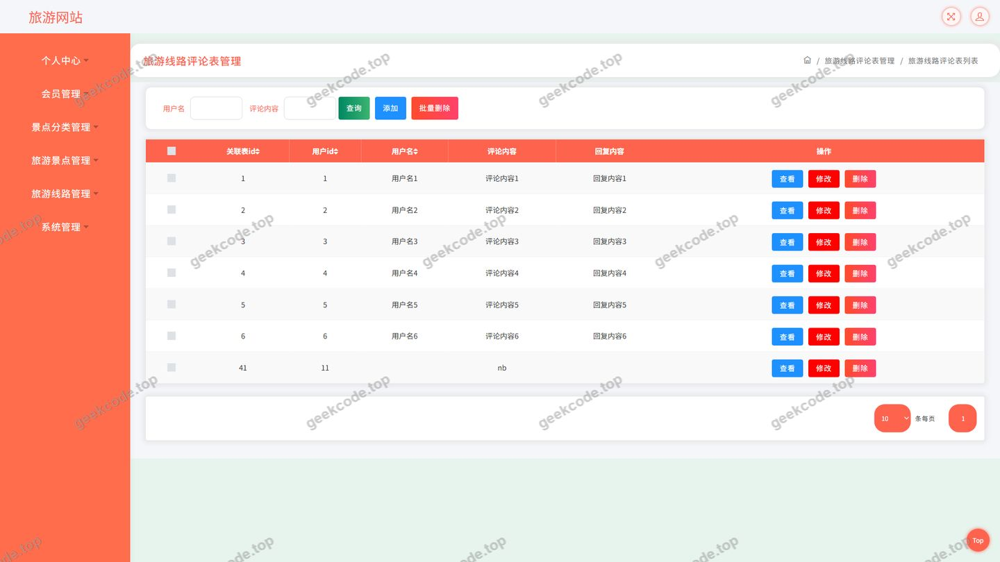
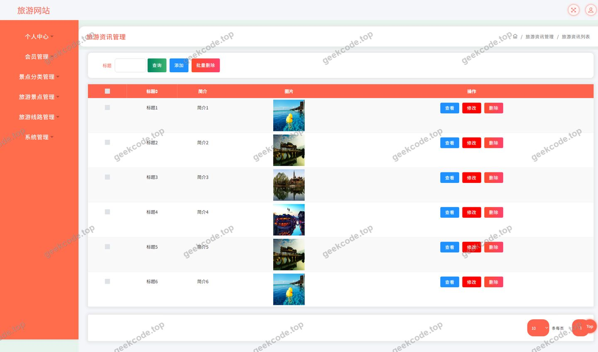
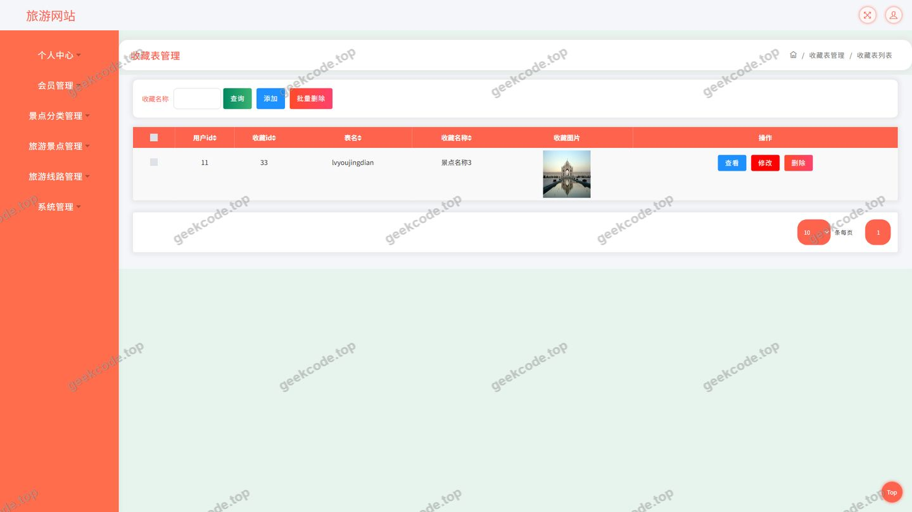

# java项目旅游景点线路网站java毕业设计

> 🎓 **计算机毕业设计 · java项目旅游景点线路网站java毕业设计**
>
> 本仓库只放**项目介绍 + 运行截图**（截图是站点带水印的原图，存在仓库 `images/` 里）。
>
> 👉 **完整可运行源码 / 数据库脚本 / 部署文档：[点我获取](https://geekcode.top/archives/java%E9%A1%B9%E7%9B%AE%E6%97%85%E6%B8%B8%E6%99%AF%E7%82%B9%E7%BA%BF%E8%B7%AF%E7%BD%91%E7%AB%99java%E6%AF%95%E4%B8%9A%E8%AE%BE%E8%AE%A1?utm_source=github)**
>
> 💬 咨询微信：**ir9372**　|　🌐 更多项目：[极客代码 geekcode.top](https://geekcode.top/?utm_source=github)
>
> 📌 项目详情页：<https://geekcode.top/archives/java%E9%A1%B9%E7%9B%AE%E6%97%85%E6%B8%B8%E6%99%AF%E7%82%B9%E7%BA%BF%E8%B7%AF%E7%BD%91%E7%AB%99java%E6%AF%95%E4%B8%9A%E8%AE%BE%E8%AE%A1?utm_source=github>

<table><td width="230" align="center"> <b>扫码加微信 ir9372</b></td><td valign="middle">📦 源码 = 项目介绍 + 全部运行截图 + 数据库 + 部署文档 👉 点上方任意截图，直接跳到 <b>极客代码 geekcode.top</b> 详情页</td></table>

---

<h1>java项目_旅游景点线路网站_java毕业设计</h1>
<h2>项目概述</h2>

本项目为面向旅游出行场景的信息服务与管理平台，围绕“景点—线路—资讯”三条主线构建数据服务能力。系统以旅游景点、旅游线路为核心资源，配套景点分类、评论互动、收藏夹、会员体系与新闻资讯模块，为游客提供景点与线路的浏览、检索、评价与收藏服务，同时为运营方提供会员、景点、线路、分类、评论、资讯等数据的维护能力。

核心功能包括：旅游景点与旅游线路的展示与查询、景点分类管理、景点评论与线路评论、会员注册登录与个人中心、我的收藏、旅游资讯与新闻资讯发布、文件上传下载以及系统配置读取。

适用人群为需要短途或长途出行的自助游客，以及负责内容与资源维护的旅游平台运营人员；亦适合作为 Java Web 方向毕业设计的技术参考项目。

技术架构上，项目基于 Spring 框架体系构建，采用分层结构组织代码，持久层使用 MyBatis-Plus 完成数据访问与条件构造，数据源由 Druid 连接池统一管理，对外以接口形式提供数据服务。

<h2>技术架构</h2>
<h3>整体架构</h3>

项目为接口服务型工程（pure-api），业务能力通过 Controller 层以 HTTP 接口形式对外暴露，未内置前端页面资源与前端路由。客户端通过调用接口获取景点、线路、资讯、评论、收藏等数据并完成交互。系统内部按控制层、业务层、持久层分层组织，各层职责单一、依赖方向明确。

控制器层由 <code>CommonController</code>、<code>ConfigController</code>、<code>FileController</code>、<code>UserController</code>、<code>HuiyuanController</code>、<code>LvyoujingdianController</code>、<code>LvyouxianluController</code>、<code>JingdianfenleiController</code>、<code>DiscusslvyoujingdianController</code>、<code>DiscusslvyouxianluController</code>、<code>StoreupController</code>、<code>NewsController</code> 组成，分别对应公共能力、配置读取、文件处理、用户与会员、景点、线路、分类、景点评论、线路评论、收藏、资讯等业务域。

<h3>数据库设计要点</h3>

数据库围绕业务实体进行组织，主要数据对象包括：旅游景点、旅游线路、景点分类、景点评论、线路评论、会员、收藏记录、新闻资讯、系统用户与系统配置。设计要点如下：

<ul>
<li>景点与线路作为主数据表，通过景点分类建立归属关系，形成“分类—景点—线路”的层级关联，便于按分类聚合展示与筛选。</li>
<li>评论数据按业务对象拆分为景点评论与线路评论两个独立控制器与数据域，评论与对应的景点、线路以及评论人建立关联，支持按对象维度查询评论列表。</li>
<li>收藏记录独立存储，通过收藏对象标识关联景点、线路等资源，并与会员账号绑定，支撑“我的收藏”列表与收藏状态判断。</li>
<li>会员与系统用户分属不同数据域，由 <code>HuiyuanController</code> 与 <code>UserController</code> 分别承载，账号信息与业务行为数据解耦。</li>
<li>系统配置以键值形式集中存放，由 <code>ConfigController</code> 统一读取，避免配置项散落在业务代码中。</li>
</ul>
<h3>核心技术选型理由</h3>
<ul>
<li><strong>Spring 框架体系（spring-core、spring-context、spring-beans、spring-aop、spring-web、spring-webmvc、spring-tx、spring-jdbc、spring-context-support）</strong>：提供 IoC 容器、依赖注入、AOP 与 MVC 能力，通过事务管理保证评论、收藏等多表操作的一致性，组件职责清晰、便于分层扩展。</li>
<li><strong>MyBatis-Plus</strong>：在 MyBatis 基础上提供通用 CRUD 与条件构造器，显著减少景点、线路、评论、收藏等高频数据操作中的样板 SQL，适合以列表查询与条件筛选为主的业务场景，同时保留自定义 SQL 的灵活度。</li>
<li><strong>Druid</strong>：作为数据库连接池，提供连接复用、SQL 执行监控与连接状态统计能力，便于在开发与测试阶段排查慢查询与连接泄漏问题。</li>
<li><strong>JUnit</strong>：用于对业务逻辑进行单元测试，保障核心数据处理逻辑的稳定性。</li>
<li><strong>文件处理独立成控制器</strong>：将上传下载能力从业务逻辑中剥离，由 <code>FileController</code> 统一承载，便于被景点封面、资讯配图等场景复用。</li>
</ul>
<h2>功能模块</h2>
<h3>前台用户端</h3>
<ul>
<li><strong>登录与账号</strong>：提供账号登录入口，完成身份校验后进入系统；会员相关数据由会员模块统一维护。</li>
<li><strong>旅游景点</strong>：展示景点列表与景点详情信息，支持按景点分类进行筛选浏览。</li>
<li><strong>旅游线路</strong>：展示线路列表与线路详情信息，供用户查看行程相关内容。</li>
<li><strong>旅游资讯 / 新闻资讯</strong>：以列表与详情形式发布旅游相关资讯与新闻内容，供用户浏览阅读。</li>
<li><strong>景点评论</strong>：用户可针对具体旅游景点发表评论并查看该景点下的评论内容。</li>
<li><strong>线路评论</strong>：用户可针对具体旅游线路发表评论并查看该线路下的评论内容。</li>
<li><strong>个人中心</strong>：展示与维护当前会员的个人信息。</li>
<li><strong>我的收藏</strong>：查看已收藏的景点、线路等资源，支持收藏的添加与取消。</li>
<li><strong>文件服务</strong>：为图片等资源提供统一的上传与访问能力，供景点、资讯等内容的配图使用。</li>
</ul>
<h3>管理端</h3>
<ul>
<li><strong>会员管理</strong>：对会员账号信息进行查询、新增、修改与删除维护。</li>
<li><strong>景点分类管理</strong>：维护景点分类数据，为景点归类与筛选提供基础。</li>
<li><strong>旅游景点管理</strong>：维护景点主数据，包括景点基本信息、所属分类及相关展示内容。</li>
<li><strong>旅游线路管理</strong>：维护线路主数据及其行程相关信息。</li>
<li><strong>景点评论管理</strong>：对景点评论进行查询与审核维护。</li>
<li><strong>线路评论管理</strong>：对线路评论进行查询与审核维护。</li>
<li><strong>旅游资讯管理</strong>：发布、编辑与下架旅游资讯内容。</li>
<li><strong>新闻资讯管理</strong>：发布、编辑与下架新闻资讯内容。</li>
<li><strong>收藏管理</strong>：查看与管理收藏记录数据。</li>
<li><strong>用户管理</strong>：维护系统用户账号信息。</li>
<li><strong>系统配置管理</strong>：读取与维护系统配置项，为其他模块提供统一配置来源。</li>
<li><strong>文件管理</strong>：统一处理文件的上传、存储与访问。</li>
</ul>
<h2>用户角色与权限</h2>
<h3>系统管理员</h3>

由 <code>UserController</code> 承载账号与权限主体，可使用平台全部管理能力，具体包括：

<ul>
<li>会员管理：会员信息的查询、新增、修改、删除。</li>
<li>景点分类管理：分类数据的查询、新增、修改、删除。</li>
<li>旅游景点管理：景点信息的查询、新增、修改、删除。</li>
<li>旅游线路管理：线路信息的查询、新增、修改、删除。</li>
<li>景点评论管理：景点评论的查询与维护。</li>
<li>线路评论管理：线路评论的查询与维护。</li>
<li>旅游资讯与新闻资讯管理：资讯内容的发布、编辑与删除。</li>
<li>收藏管理：收藏记录的查询与维护。</li>
<li>用户管理：系统用户账号的查询与维护。</li>
<li>系统配置管理：配置项的读取与维护。</li>
<li>文件管理：文件的上传与访问。</li>
</ul>
<h3>会员（普通用户）</h3>

由 <code>HuiyuanController</code> 承载账号主体，面向前台使用场景，可访问的功能包括：

<ul>
<li>账号登录与个人信息维护（个人中心）。</li>
<li>旅游景点浏览与景点分类筛选。</li>
<li>旅游线路浏览。</li>
<li>旅游资讯、新闻资讯浏览。</li>
<li>景点评论的查看与发表。</li>
<li>线路评论的查看与发表。</li>
<li>景点、线路等资源的收藏与取消收藏，以及“我的收藏”列表查看。</li>
<li>图片等文件资源的上传与访问。</li>
</ul>

两类角色在数据域上相互独立：管理员侧重数据的全量维护，会员侧重内容的浏览、互动与个人数据管理。

<h2>项目特色与创新点</h2>
<ul>
<li><strong>以“景点—分类—线路”为主线组织旅游数据</strong>：通过景点分类建立归属关系，使景点与线路形成结构化的旅游资源体系，支撑分类浏览与条件筛选，避免资源信息扁平化堆砌。</li>
<li><strong>评论能力按业务对象独立建模</strong>：景点评论与线路评论分别由独立控制器与数据域承载，评论数据与业务对象强关联，便于按对象维度聚合展示与分别管理，也便于后续扩展评分、回复等能力。</li>
<li><strong>收藏能力通用化</strong>：收藏记录独立存储并与会员账号绑定，可同时服务于景点、线路等多类资源，避免为每类资源重复建设收藏逻辑。</li>
<li><strong>持久层轻量化</strong>：采用 MyBatis-Plus 的通用 CRUD 与条件构造能力承载高频数据操作，在保证开发效率的同时保留自定义 SQL 的扩展空间，适合以列表查询、条件筛选为主的旅游信息服务场景。</li>
<li><strong>数据源可观测</strong>：引入 Druid 连接池对数据库连接进行统一管理与监控，便于定位连接占用与慢查询问题，提升系统在演示与测试阶段的稳定性。</li>
<li><strong>配置与文件能力集中化</strong>：系统配置由统一入口读取，文件上传下载由独立控制器承载，减少各业务模块的重复实现，降低维护成本。</li>
</ul>
<h2>部署环境</h2>
<ul>
<li><strong>JDK</strong>：需安装与所选 Spring 框架版本相匹配的 JDK，并正确配置 <code>JAVA_HOME</code>。</li>
<li><strong>构建工具</strong>：Maven，用于依赖管理与项目打包（依赖清单中包含 junit、spring 系列组件、MyBatis-Plus、Druid 等）。</li>
<li><strong>数据库</strong>：MySQL，需提前创建业务数据库并导入初始化表结构与基础数据。</li>
<li><strong>连接池</strong>：Druid，随项目依赖引入，需在配置中填写数据库连接地址、账号、密码及连接池参数。</li>
<li><strong>Web 容器</strong>：项目基于 Spring MVC 提供接口服务，可部署于支持 Servlet 规范的容器中运行。</li>
<li><strong>接口调试工具</strong>：可使用 Postman、Apifox 等工具对 Controller 暴露的接口进行调试与验证。</li>
<li><strong>运行环境说明</strong>：项目为接口服务型工程，未包含前端页面资源与前端路由，无需 Node.js 等前端构建环境；客户端页面需独立部署并通过 HTTP 调用本项目接口。</li>
</ul>
<h2>五、技术特性</h2>
<ul>
<li>使用 MyBatis-Plus 简化数据访问层开发</li>
</ul>
<h2>六、功能模块截图</h2>
<h3>后台管理端</h3>
<h4>页面-登录</h4>

<h4>页面-会员</h4>

<h4>页面-景点分类</h4>

<h4>页面-旅游景点</h4>

<h4>页面-旅游景点评论</h4>

<h4>页面-旅游线路</h4>

<h4>页面-旅游线路评论</h4>

<h4>页面-旅游资讯</h4>

<h4>页面-收藏</h4>

---

## 获取完整源码

| 项目 | 说明 |
| --- | --- |
| 项目名 | java项目旅游景点线路网站java毕业设计 |
| 运行截图 | 本文 10 张（站点带水印原图，仓库 `images/` 目录） |
| 完整源码 | [https://geekcode.top/archives/java%E9%A1%B9%E7%9B%AE%E6%97%85%E6%B8%B8%E6%99%AF%E7%82%B9%E7%BA%BF%E8%B7%AF%E7%BD%91%E7%AB%99java%E6%AF%95%E4%B8%9A%E8%AE%BE%E8%AE%A1?utm_source=github](https://geekcode.top/archives/java%E9%A1%B9%E7%9B%AE%E6%97%85%E6%B8%B8%E6%99%AF%E7%82%B9%E7%BA%BF%E8%B7%AF%E7%BD%91%E7%AB%99java%E6%AF%95%E4%B8%9A%E8%AE%BE%E8%AE%A1?utm_source=github) |
| 咨询微信 | **ir9372**（备注：jingpin-yuanma） |
| 更多项目 | [极客代码 geekcode.top](https://geekcode.top/?utm_source=github) |

> 需要源码、部署、改配置、跑不起来等问题，加微信 ir9372 沟通，说明项目名即可。
